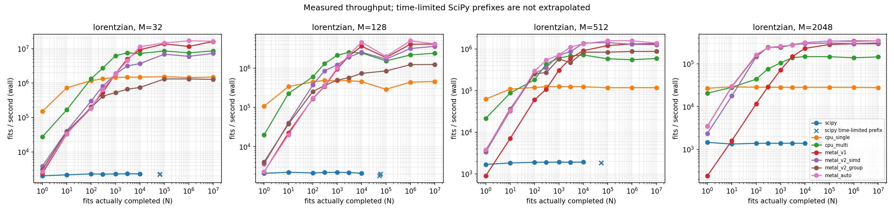

# batchfit

**Fit many independent spectra on CPU or Apple Metal, without a Python loop.**
batchfit is a C++20 library with typed NumPy bindings, analytic model Jacobians,
bounded Levenberg–Marquardt fitting, data-only initial guesses, optional parameter
uncertainties and bounded-memory NPY streaming. The float64 CPU reference is the
numerical source of truth; GPU results are checked against it.

- CPU: float32/float64, fixed-size single-fit workspace and a reusable `std::jthread` pool.
- Metal: float32, shared buffers, thread-/SIMD-/threadgroup-per-fit kernels and measured dispatch.
- Python: contiguous-input borrowing, GIL release, NumPy outputs and `.pyi` stubs.
- Diagnostics: fit/uncertainty statuses, checked Metal errors, CPU parity and Monte Carlo coverage tests.

**Status:** implemented and locally verified, not universally validated across
devices or inputs. See [the capability/evidence matrix](VERIFICATION.md) and
[prioritized future work](ROADMAP.md). Metal System Trace/shader-profiler metrics,
other-device/OS/Python coverage and a standalone C++ install package remain open;
three allocated pipeline slots do not imply three pending large-file commands.

## Build and install locally

Requirements: a C++20 compiler, CMake 3.24+, and Python **3.9–3.12** for the pinned
Python environment. Metal requires **macOS 15+ and a supported GPU**. Apple's
Command Line Tools supply Clang/framework headers; runtime shader compilation
does not require the optional offline Metal compiler. CPU-only builds neither
fetch metal-cpp nor link Apple frameworks.

Keep tools/packages inside this repository and preserve supplied HOME/TMPDIR/cache
settings. Use local **uv 0.9.8**; if absent, unpack its pinned platform archive
under `.tools/` rather than installing globally. For an existing Apple Silicon
local installation:

```sh
export PATH="$PWD/.tools/uv-aarch64-apple-darwin:$PWD/.venv/bin:$PATH"
sh scripts/bootstrap.sh             # preserves an existing .venv; installs .[dev]
uv pip install -e .                 # editable pybind11/scikit-build-core package
```

The exact tool/dependency pins live in `pyproject.toml` and `uv.lock`. No Python
interpreter is downloaded by bootstrap. CMake obtains pinned GoogleTest/Benchmark
archives in `build/`, and Metal headers in `third_party/metal-cpp/` when enabled.

```sh
cmake --preset cpu
cmake --build --preset cpu
ctest --preset cpu

cmake --preset metal                # macOS; BATCHFIT_METAL=ON is its default
cmake --build --preset metal
ctest --preset metal
```

For a minimal C++ CPU library without test/benchmark downloads:

```sh
cmake -S . -B build/minimal -G Ninja -DBATCHFIT_METAL=OFF \
  -DBATCHFIT_BUILD_TESTS=OFF -DBATCHFIT_BUILD_BENCHMARKS=OFF
cmake --build build/minimal --parallel 2
```

Consumers inside a CMake project can `add_subdirectory(...)` and link
`batchfit::batchfit`. Python installation can explicitly choose the backend:

```sh
uv pip install --reinstall-package batchfit -e . -Ccmake.define.BATCHFIT_METAL=OFF
# Restore a Metal-enabled editable build on macOS:
uv pip install --reinstall-package batchfit -e . -Ccmake.define.BATCHFIT_METAL=ON
```

After C++ edits, reinstall with `--reinstall-package batchfit`; pure Python edits
are editable immediately. [Python API/build details](python/README.md).

## Python quickstart

```python
import numpy as np
import batchfit

x = np.linspace(-5, 5, 129, dtype=np.float32)
centers = np.linspace(-0.5, 0.5, 1000, dtype=np.float32)
y = 2 / (1 + ((x[None, :] - centers[:, None]) / 0.7)**2)
rng = np.random.default_rng(123)
y += 0.02 * rng.standard_normal(y.shape, dtype=np.float32)

result = batchfit.fit(
    x, y, model="lorentzian", p0=None,
    bounds=([0, -5, 1e-4], [np.inf, 5, 5]), device="auto",
)
params, status, iterations, chi2 = result
good = status == batchfit.FitStatus.converged
fitted_centers = params[good, 1]
```

Inputs are shared `x[M]`, fit-major `y[N,M]`; a single `y[M]` means N=1.
`p0[P]` broadcasts, `p0[N,P]` supplies individual guesses, and None invokes
feature-based guesses. Bounds are common scalar/[P] lower/upper arrays; equal
finite bounds fix a coordinate. Default bounds are unbounded, so positive width
and `[0,1]` mixing bounds are recommended.

Outputs are params `[N,P]`, status/iterations/chi2 `[N]`. Chi2 is the **unweighted
residual sum of squares**. Status codes: 0 converged, 1 iteration budget,
2 singular matrix, 3 invalid input, 4 degenerate spectrum, 5 unresolved peak.
Inspect status before using parameters; bad rows are not silently removed.

`device="cpu"` preserves float32/float64. Auto uses available Metal for common
float32 inputs and keeps float64 on CPU. Explicit Metal uses float32 and **never
silently falls back**. Suitable aligned/native/C-contiguous CPU arrays are borrowed;
dtype/order/alignment conversions and Metal's point-major preparation require
copies. Inputs must not be mutated/resized while the GIL is released. Python
fitting calls serialize native work and use two CPU workers.

Request `uncertainties=True` for a seven-array `FitResultWithUncertainties` with
`.covariance[N,P,P]`, `.stderr[N,P]` and `.uncertainty_status[N]`. No uncertainty
buffers are allocated by default. Covariance is undamped `(J.T@J)^-1` at the
accepted solution, scaled by `chi2/(M-P_free)`; failed/singular/no-DOF/active-bound
cases return explicit unavailable status and NaNs, not false zero error bars.
[Uncertainty assumptions and measured coverage](NUMERICS.md#parameter-uncertainties-turn-13).

## Supported models

All amplitudes are **peak heights**, not integrated areas. Widths must be positive.
The first three models have no baseline parameter.

| Python model | Parameter order | Width convention |
|---|---|---|
| `gaussian` | amplitude, center, sigma | Gaussian standard deviation |
| `lorentzian` | amplitude, center, HWHM | half-width at half maximum |
| `pseudo_voigt` | amplitude, center, FWHM, mixing | common FWHM; mixing 0=Gaussian, 1=Lorentzian |
| `two_lorentzian` | amplitude1, center1, HWHM1, amplitude2, center2, HWHM2, intercept, slope | two peaks plus shared `intercept+slope*x` |

See [model formulas/domains](DESIGN.md#shared-model-definitions). Automatic guesses
target positive, resolved emission peaks on a calibrated grid. Difficult blends,
clipped peaks or unsuitable baselines may need explicit guesses or another model.

## C++ and out-of-core use

```cpp
#include <batchfit/batchfit.hpp>

const double initial[3] = {2.0, 0.0, 0.8};
batchfit::cpu::SolverOptions<double, 3> options;
options.lower[0] = 0.0;
options.lower[2] = 1e-4;
auto result = batchfit::cpu::fit_single<double, batchfit::models::Lorentzian>(
    x, y, initial, options); // x/y are spans or contiguous containers
```

The pooled CPU batch API is `cpu::fit_batch<T,Model>(x,y,initial,pool,options)`.
Metal callers allocate a `metal::SharedBatch` through `metal::Context`, fill its
shared point-major observation spans, then call `fit_batch` or `submit_batch`.
For files larger than RAM, `metal::fit_npy` window-maps float32/float64 NPY inputs
into at most three reusable slots and invokes ordered chunk consumers. The
`batchfit_generate` and `batchfit_fit_npy` tools support synthetic/streamed work.
[Typed API/layout contracts](DESIGN.md), [large-file results](BENCHMARKS.md).

## Add a model

1. Start CPU-only with a scalar template exposing `parameter_count` (1–8),
   `eval(x,params)` and `jacobian(x,params,out)`. `cpu::fit_single` accepts that
   template without a registry or Python callback.
2. For a shared CPU/MSL model, follow `Gaussian` in `include/batchfit/models.hpp`:
   plain fixed arrays, `ParameterName` metadata, `BATCHFIT_MODEL_THREAD` qualifiers
   and shared math macros; no C/C++ library headers, dynamic storage, shader
   double or shader string metadata. Document parameter order/domains/widths.
3. Check the analytic Jacobian against central finite differences in float and
   double, then add recovery, bounds/failure, allocation and covariance tests.
4. GPU/Python model selection is **compiled and fixed**, not a plugin mechanism.
   Extend kernel instantiations in `lm.metal`, `cooperative.metal` and
   `uncertainty.metal`; update model/name/index tables in `metal/batch.hpp`,
   `src/metal/storage.hpp` and runtime pipeline indexing/cache sizes together.
   Add Python dispatch/counts/Literals, and synthetic generation/initialization
   support when those interfaces should expose the model.
5. Verify all forced GPU variants and automatic dispatch against CPU on identical
   stored inputs, including tails and bad rows; extend independent MSL model,
   SciPy/coverage tests and measured dispatch policy. Never weaken a tolerance to
   hide a new model's mismatch. Finish with the full local check script.

## Performance



On the recorded **Apple M4 / Mac16,10**, all native paths actually processed up to
**10 million fits**, M=32–2048, in bounded chunks. At N=10 million automatic Metal
wall throughput was **16.32M, 4.166M, 1.381M and 346.6k fits/s** for those four M
values: **1.73x–2.38x** the ten-worker CPU path. Packing/transposition consumed
25.5%–45.2% of wall time, so kernel-only rates are not end-to-end speedups.

Warm GPU advantage over the better CPU path became stable by N=10,000 for
M=32/128 and N=100 for M=512/2048; cold GPU setup was separately measured at
1.381 s. This is a Lorentzian study cycling 1,024 deterministic patterns, not
ten million unique random spectra. Large SciPy loops were explicitly time-limited
and plotted only at their actual completed counts—never extrapolated to full N.
[Full timings/limitations](BENCHMARKS.md), [benchmark commands](bench/README.md),
[profiling measurements vs unavailable counters](PROFILING.md).

## Float32 accuracy

Metal has no float64 shader arithmetic. CPU float64 remains the reference;
safe/precise GPU math is the default, while fast math is experimental. Normalize
**original double data before float32 conversion** when coordinate offsets/scales
are troublesome; lost input bits cannot be recovered afterward. Optional Kahan
accumulation and scaled Cholesky help, but normalization was the largest measured
remedy. Baseline centering couples paired intercept/slope bounds and covariance:
never silently transform physical boxes or rescale only diagonal errors.

The recorded 122,880-fit study's normalized safe Kahan/scaled recipe had unit-
parameter RMS error **4.77e-6**, maximum **1.51e-4**, against fitted CPU64 results;
these are workload measurements, not universal tolerances. Ordinary SciPy tests
and 10,000-realization coverage per model/backend also run locally. See
[NUMERICS.md](NUMERICS.md) for raw/normalized, safe/fast, pathology and uncertainty
tables, rejected estimates and retained failed experiments.

## Run every local check

```sh
sh scripts/check.sh                 # complete gate; Metal required on macOS
sh scripts/check.sh --cpu-only      # same CPU-only gate; no Metal tests/fetch
```

The gate covers formatting, clang-tidy, normal and **combined ASan/UBSan C++
suites**, Metal tests with **`MTL_DEBUG_LAYER=1 MTL_SHADER_VALIDATION=1`**, Python
agreement/coverage, CLI checks, bounded benchmark smoke and actual IPC-kernel
notebook execution. Ordinary builds/tests use at most two workers; large Release
studies are explicit, not part of the gate. Sanitizer findings stop the gate;
batchfit code is not suppressed. See [VERIFICATION.md](VERIFICATION.md) for exact
counts, upstream-only UBSan exclusion, cleanup, historical vs current checks and
unverified platforms/tooling. A CPU-only or local pass is not a GPU/CI matrix pass.

Pre-publication checks also rebuilt a wheel from the source distribution and
verified isolated CPU64/Metal32 fitting, covariance and typing files. Fresh
project-local dependency downloads work; earlier DNS limitations in the retained
study notes are historical. The final macOS arm64 gate passed **120 CTest
executions, 74 Python tests, 56 benchmark smoke cases** and the full notebook,
including ASan/UBSan and Metal API/shader validation. See the verification guide
for platform limits.

## Demo and further documentation

The executed [hyperspectral notebook](examples/hyperspectral_demo.ipynb) fits a
512×512×129 cube, recovers all 262,132 healthy pixels and flags 12 defects, with
parameter/status/error maps and a real `cube.npy[H,W,M]` + `x.npy[M]` example.
[Project-local Jupyter setup and limitations](examples/README.md).

- [Design and model/API contracts](DESIGN.md)
- [Verification commands, capability/evidence matrix and limitations](VERIFICATION.md)
- [Prioritized roadmap, acceptance criteria and effort estimates](ROADMAP.md)
- [Python API, statuses, copies, ownership and build details](python/README.md)
- [Benchmark results and reproducible plots](BENCHMARKS.md)
- [Numerical accuracy and uncertainty coverage](NUMERICS.md)
- [Profiling and trace reproduction](PROFILING.md)

## License

[MIT](LICENSE) © 2026 Mykyta Kizilov.
